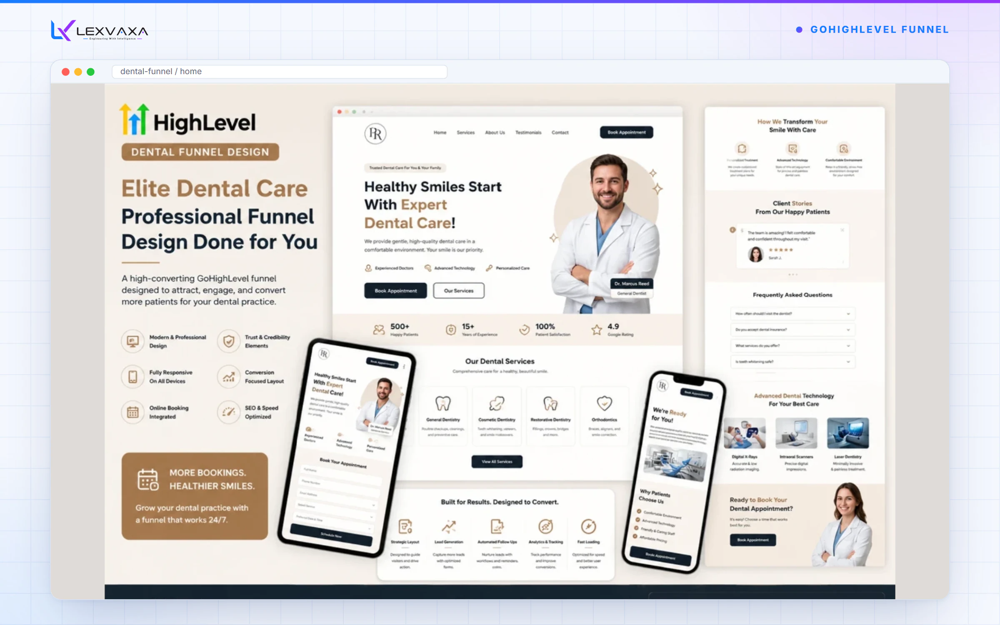

<!-- styled:v2 -->

**A mobile-friendly GoHighLevel funnel for a dental practice that builds trust and guides visitors straight to booking a consultation.**

  
  
  
  
  
  

  <a href="#overview">Overview</a> ·
  <a href="#key-features">Key features</a> ·
  <a href="#results">Results</a> ·
  <a href="#tech-stack">Tech stack</a>

---

## Overview

A dental practice needed a trustworthy, mobile-friendly patient journey with a clear path to booking. Lexvaxa built a lead generation funnel in GoHighLevel with a landing page that highlights services and dentist information, testimonials and trust elements, clear calls to action and integrated online appointment booking. Screens shown use sample data, so no client records are exposed.

## The challenge

Visitors were leaving the old site without booking because the path to an appointment was not clear.

## The solution

A focused GoHighLevel funnel with service highlights, social proof and booking built into every step.

## Key features

- Landing page with service highlights and dentist information
- Testimonials and trust elements
- Clear calls to action
- Integrated online appointment booking
- Mobile-friendly design

## Results

- A conversion-focused funnel that guides visitors to book a consultation

## Tech stack

   

## Privacy

Client names and records are confidential. Every screen in this repository uses sample data, and source code that belongs to the client is not published.

## Links

- Case study on Lexvaxa: https://lexvaxa.com/work/ghl-dental-lead-funnel

---

**Built by [Ch Muhammad Samiullah](https://github.com/samiullah156-creator)** · AI Automation Engineer and Full-Stack Developer at [Lexvaxa](https://lexvaxa.com)

⭐ Star this repo if you found it useful

